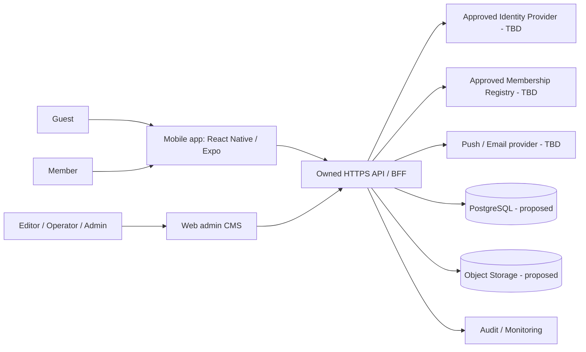
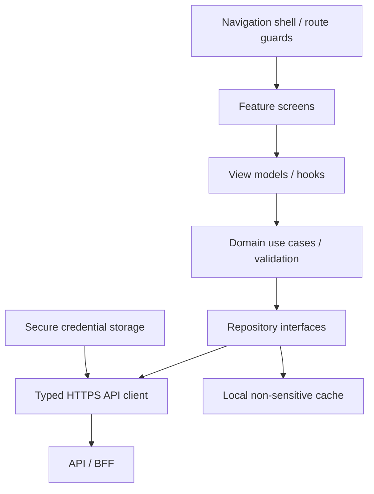
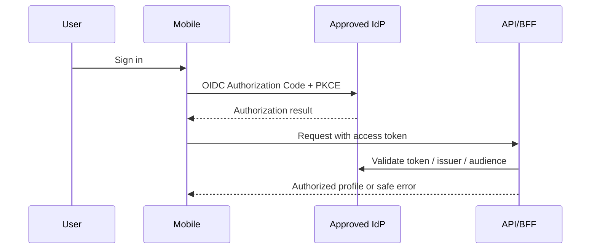
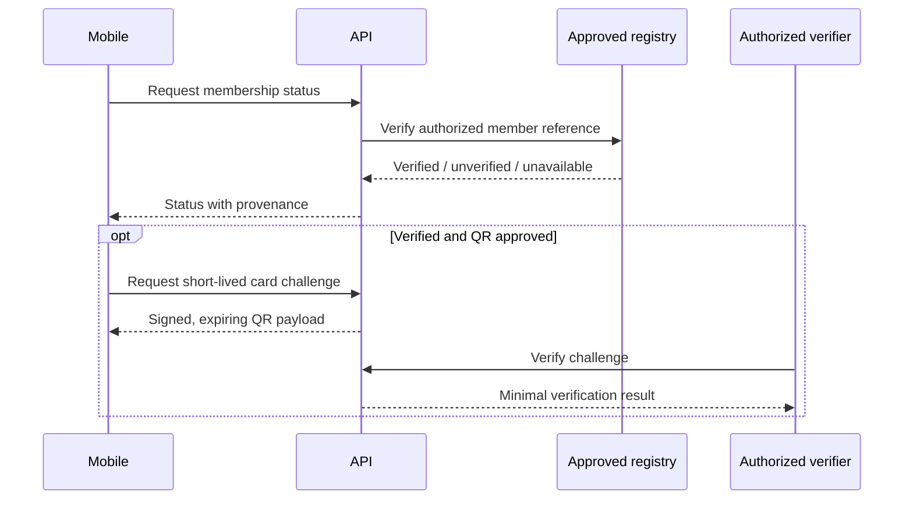
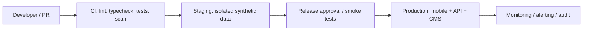

# SAD.md — KADIN Indonesia Next Generation Mobile Platform

**System Architecture Document** | **Version:** 1.0 | **Date:** 2026-11-18  
**Status:** Proposed architecture baseline — **not approved for production**  
**Source of truth:** `PRD.md`, `AGENTS.md`, `APK-ANALYSIS.md`, `FEATURE-INVENTORY.md`, `UIUX-ANALYSIS.md`, `SCREEN-INVENTORY.md`.

## 1. Purpose, boundaries and evidence

Define a buildable, secure **successor** architecture for the KADIN Indonesia mobile platform, admin CMS, API services and supporting infrastructure. The reference APK is a discovery artifact, **not** source code or an approved API contract. Static APK analysis supports React Native/Expo/Hermes packaging and several candidate assets/dependencies; it does **not** establish runtime flows, legacy backend design or the existence of functional modules. All architecture below is **PROPOSED** until approved.

**Product goals:** member-facing digital identity and membership access; public content and service discovery; admin-managed publishing and operations; extensible events, directories and business development services. Clean-room implementation only. No copying of decompiled code, protected assets, credentials or unapproved endpoints.

## 2. Scope and architectural principles

**P0:** guest/member navigation, authentication/consent, profile and membership status, digital card/QR (integration-gated), news, service catalogue, settings, admin CMS, role-based administration, audit/telemetry.  
**P1:** events, regional/association and business directories, renewal/payment (approval-gated), training/mentoring, opt-in push.  
**P2:** moderated chat/AI copilot and specialist services (COO, ATA Carnet, APEC), each subject to owner/legal approval.

Principles: API-first; independent mobile/backend releases; least privilege; deny-by-default; no direct mobile database access; explicit organizational scope; privacy-by-design; accessibility; observable operations; reversible architecture decisions; feature flags; offline-safe public content where appropriate; testability and TDD.

## 3. System context (C4 level 1)

**Trust boundaries:** untrusted mobile device/browser → HTTPS API; API → internal services/data; API → external identity/registry/notification providers. Treat any external payload as untrusted. Only approved integrations may cross provider boundaries.

## 4. Logical container architecture (C4 level 2)

| Container | Responsibility | Technology baseline | Exposure |
|---|---|---|---|
| Mobile | Screens, navigation, session presentation, offline cache, accessibility | React Native + Expo + TypeScript | Public app |
| Admin CMS | Content editing, approval, service queues, role management | TypeScript web app (framework TBD) | Restricted web |
| API/BFF | Auth token validation, aggregation, authorization, validation, rate limiting, versioned contracts | TypeScript backend (framework TBD) | HTTPS |
| Identity module | IdP adapter, session policy, account linking, revocation | Backend module + approved IdP | Internal |
| Membership module | Registry adapter, verified status, member card claims | Backend module | Internal |
| QR verification module | Issue/verify short-lived signed references, revocation/status | Backend module | Controlled public verifier |
| Content module | News, announcements, publication workflow | Backend module | Internal |
| Service catalogue module | Services, eligibility metadata, enquiry workflow | Backend module | Internal |
| Administration module | Roles, organization scoping, audit trail | Backend module | Internal |
| Persistence | Transactional records, CMS data, references | PostgreSQL (proposed) | Private network |
| Object storage | Approved media, images, attachments | Provider TBD | Signed access |
| Observability | Metrics, traces, logs, security audit | Vendor TBD | Restricted |

**Deployment recommendation:** begin with a **modular monolith** behind one BFF/API boundary, separating domains in code and contracts. Split into services only when scaling, ownership or regulatory evidence justifies it. This minimizes initial operational cost.

## 5. Mobile application architecture

Use feature-first structure (`src/features/<feature>/{components,screens,domain,data,__tests__}`) and shared design system, auth, API client and error handling. TypeScript strict mode. **Expo Router vs React Navigation** and **Expo managed vs prebuild** require ADR approval. Prefer React Query/TanStack Query for remote state only if approved; avoid duplicating global state systems. Keep authorization server-side; client route guards improve UX but are not security boundaries. Use platform secure storage for tokens; never store tokens in AsyncStorage or logs. No app-embedded API secrets.

## 6. Domain decomposition and responsibilities

| Domain | Core aggregates / records (proposed) | Key rules |
|---|---|---|
| Identity | User, Session, Consent | IdP-verified identity; revoke sessions; consent versioning |
| Organization | Organization, RoleAssignment | National/regional scope explicit; no inferred affiliations |
| Membership | MemberProfile, MembershipVerification | Verified registry is authority; unknown status remains unknown |
| Digital identity | CardPresentation, QRChallenge | Expiry, replay mitigation, verification audit, revocation |
| Content | Article, Media, Publication | Draft → review → publish; editor approvals |
| Service | ServiceDefinition, Enquiry | Eligibility and operator routing configurable |
| Operations | AuditEvent, NotificationPreference | Immutable audit semantics; opt-in communications |
| Events (P1) | Event, Registration | Capacity and duplicate controls |
| Directory (P1) | BusinessListing | Explicit consent to public listing |
| Renewal (P1) | RenewalRequest, PaymentReference | No payment until provider/legal approvals |
| AI (P2) | KnowledgeSource, Conversation, Escalation | Approved knowledge, citations, human escalation |

## 7. Data architecture

Proposed PostgreSQL for operational records, with logical schemas or namespaces by domain. Key relationships: `users` 1:N `role_assignments`; `organizations` 1:N `role_assignments`; `users` 0:1 `member_profiles`; `member_profiles` 0:N `membership_verifications`; `articles` N:1 `authors`; `service_enquiries` N:1 `service_definitions`; `audit_events` reference actor/resource/action. Store only registry references and necessary derived verification fields; avoid unnecessary replication of national membership records.

Use UUID identifiers; UTC timestamps; explicit soft-delete/retention policies; migrations checked into repository; foreign keys, uniqueness and indexes; encryption in transit and at rest; restricted backups. PII classification, retention periods, residency and data-controller roles remain **TBD**. Never place PII in analytics events, push payloads or logs.

## 8. API design and contract governance

Base path proposal `/api/v1`; HTTPS/JSON, OpenAPI 3.1, stable error envelope (`code`, `message`, `requestId`), pagination, request correlation, idempotency keys for writes where needed. API examples are **new proposed contracts**, not recovered legacy endpoints.

| Endpoint (illustrative) | Auth | Domain | Gate |
|---|---|---|---|
| `GET /api/v1/news` | Public | Published content | P0 |
| `GET /api/v1/news/{id}` | Public | Article details | P0 |
| `GET /api/v1/services` | Public | Catalogue | P0 |
| `GET /api/v1/me` | Member | Profile | IdP decision |
| `GET /api/v1/me/membership` | Member | Verified membership | Registry decision |
| `POST /api/v1/me/card/challenges` | Member | Short-lived QR claim | QR policy approval |
| `POST /api/v1/qr/verify` | Authorized verifier | Verification | QR policy approval |
| `POST /api/v1/service-enquiries` | Policy-dependent | Enquiry | Routing approval |
| `POST /api/v1/admin/articles` | Scoped editor | Draft content | RBAC approval |
| `POST /api/v1/admin/articles/{id}/publish` | Scoped approver | Publication | Workflow approval |

Do not implement or connect live identity/registry/QR APIs before approval. Use contract tests and synthetic mock providers until approved.

## 9. Key sequences

### 9.1 Member sign-in (proposed)

Use OIDC + PKCE if compatible with the selected provider. Exact identity lifecycle and provider are unresolved.

### 9.2 Membership verification and QR (proposed)

Never issue a verified badge when registry data is unavailable. QR payload should minimize PII; define TTL, replay defense, verifier authorization and revocation in an approved ADR.

## 10. Security and privacy architecture

- **Authentication:** OIDC/OAuth2 with PKCE (proposal), secure storage, short-lived access, refresh rotation where supported; no secrets in app.
- **Authorization:** server-side RBAC plus organization-scope checks for every admin and member resource; deny by default; periodic access review.
- **Transport:** TLS, managed certificates, no cleartext production traffic; standard mobile network security config.
- **Data:** encryption at rest; key management via managed secret store; least-privilege database roles; redact PII and tokens.
- **Threat controls:** rate limiting, input validation, anti-enumeration, replay protection, abuse monitoring, file upload scanning and content type limits.
- **Supply chain:** lockfiles, dependency scanning, SBOM, secret scanning, signed builds, CI provenance and least-privilege CI identities.
- **Privacy:** consent records, deletion/access request workflow subject to retention policy, purpose limitation and Indonesian PDP compliance review.
- **Audit:** record actor, action, target, scope, outcome, timestamp, requestId; tamper-resistant retention; no sensitive payload dumps.
- **Mobile:** avoid hardcoded credentials, exposed deep links and insecure WebViews; verify universal/app links and handle compromised-session recovery.

Security control design must be reviewed before production release; this document is not a completed security assessment.

## 11. Deployment and environments

Environments: local, test/CI, staging, production. Separate IdP clients, secrets, databases and storage per environment. Mobile builds through an approved Expo EAS or equivalent pipeline (decision pending). API/CMS host, region, disaster recovery provider and DNS/CDN remain TBD. Infrastructure as code and managed backups required before production. Prefer staged rollout with kill switches/feature flags; document rollback for API, mobile configuration and database migrations.

## 12. Reliability, performance and observability

**Proposed targets pending baseline and approval:** login success ≥98% excluding invalid credentials; QR verification success ≥99% under healthy dependencies; crash-free sessions ≥99.5%. Define p95 latency, availability, RPO/RTO and error budgets after pilot measurements. Instrument mobile crashes, API latency/error rate, database health, registry adapter failures, QR verification failure categories, content publication and service enquiry completion. Include trace/request IDs; alert on elevated 5xx, auth anomalies, provider outages and queue backlog. When registry is unavailable, show **unverified/unavailable** rather than a fabricated membership state.

## 13. Test strategy and quality gates

- **Unit:** domain rules, navigation guards, membership status mapping, QR expiry/replay logic, validation, authorization policies.
- **Integration:** API ↔ database, IdP/registry adapters with fakes, publication workflow, organization scoping.
- **Contract:** OpenAPI compatibility and consumer-driven API checks.
- **Mobile UI:** guest navigation, sign-in gate, loading/error/empty states, logout, accessibility.
- **E2E:** critical guest/member/admin journeys on staging with synthetic identities.
- **Security:** SAST, dependency/SBOM, secret scanning, authorization negative tests, threat-model review, independent penetration testing before production where required.

**TDD workflow:** write failing test (RED) → minimal implementation (GREEN) → refactor → run full relevant suite. Do not claim a test/build/emulator check passed unless executed and evidenced. CI must block on failing typecheck, lint, tests and critical security findings.

## 14. Repository and ownership model

**Repository layout:** `docs/adr/ADR-012-repository-layout-canonicalization.md` (ACCEPTED) is the single source of truth for the repository tree: top-level folders, `packages/` contents and doc placement. This section deliberately does not restate a tree, so the two cannot drift apart.

**Never commit:** original APK, JADX/Apktool output, Hermes bundle, unlicensed legacy assets, raw production logs, secrets or PII. Store research artifacts separately with access controls.

## 15. Architecture decision records required

| ADR | Decision | Default recommendation | Status |
|---|---|---|---|
| ADR-001 | Expo managed vs prebuild | Managed with Continuous Native Generation (B-001 scope) — `docs/adr/ADR-001-expo-workflow.md` | ACCEPTED 2026-11-21 |
| ADR-002 | Expo Router vs React Navigation | Expo Router — `docs/adr/ADR-002-navigation-library.md` | ACCEPTED 2026-11-21 |
| ADR-003 | Identity provider and account linking | OIDC/PKCE-compatible provider | BLOCKING for live auth |
| ADR-004 | Membership registry authority and contract | Read-only verified adapter first | BLOCKING for live membership |
| ADR-005 | QR purpose, verifier, TTL, revocation | Signed short-lived challenge | BLOCKING for live QR |
| ADR-006 | National/regional tenant and role scope | Explicit org-scoped RBAC | BLOCKING for admin |
| ADR-007 | Backend runtime, CMS, DB and hosting | Modular monolith + PostgreSQL | OPEN |
| ADR-008 | Residency, retention, consent and privacy | Legal/data-owner approval | BLOCKING for production |
| ADR-009 | Notification and analytics providers | Opt-in and privacy-minimal | OPEN |
| ADR-010 | P1 payment/renewal partner and rules | Defer to P1 | BLOCKING for payments |
| ADR-011 | AI knowledge, model, escalation | Defer to P2 | BLOCKING for AI |
| ADR-012 | Repository layout canonicalization (doc placement, `packages/` contents) | See `docs/adr/ADR-012-repository-layout-canonicalization.md` (Amendment 1: specs stay at root) | ACCEPTED 2026-11-21 |

## 16. Delivery roadmap and architecture gates

| Stage | Deliverable | Exit criteria |
|---|---|---|
| G0 Discovery | Verified screen/feature observations, source traceability | Unknowns and assumptions labeled |
| G1 Architecture | Approved ADRs for P0, data ownership, threat model | Product/security owners sign off |
| G2 Foundation | Monorepo, typed contracts, mock IdP/registry, CI | Tests and static checks pass |
| G3 P0 build | Public content, navigation, service catalogue, admin CMS | Epic acceptance tests pass |
| G4 Integration | Approved identity/registry/QR adapters | Negative tests, access controls, audit evidence |
| G5 Pilot | Staging/pilot, telemetry, user testing | KPI baseline and operational readiness |
| G6 Production | Release candidate, rollback, DR, privacy/security review | Formal release approval |

Suggested implementation order: design system and navigation → public news/services → admin CMS and RBAC → mock profile/membership → approved identity/registry → QR verification → pilot. P1/P2 require separate gates.

## 17. Risks and mitigations

| Risk | Impact | Mitigation |
|---|---|---|
| Legacy APK assumptions mistaken for verified behavior | Wrong requirements | Confidence labels, emulator validation, PO sign-off |
| Unavailable/incorrect membership registry | False identity claims | Fail closed, status provenance, contract tests |
| Cross-region admin data exposure | Privacy/security incident | Server-enforced organization scope, negative tests |
| QR replay or forgery | Identity misuse | Short TTL, signed token, revocation, authorized verifier |
| Vendor lock-in | Higher TCO | Adapter interfaces, ADRs, export/exit plan |
| Mobile/backend release mismatch | User failures | Versioned contracts, backward compatibility, staged rollout |
| Sensitive data in AI prompts/logs | Privacy breach | Sanitization, access controls, restricted research workspace |

## 18. Responsibility matrix (proposed)

| Decision/activity | Product Owner | Architect | Security/Privacy | Engineering | KADIN Data/Service Owner |
|---|---|---|---|---|---|
| Product requirements | A | C | C | R | C |
| Architecture/ADRs | C | A/R | C | R | C |
| Identity, registry and QR policy | C | R | R | C | A |
| Feature implementation | C | C | C | A/R | I |
| Security/privacy release gate | C | R | A | R | C |
| Production go-live | A | R | R | R | C |

R = Responsible, A = Accountable, C = Consulted, I = Informed. Named owners and actual authority require confirmation.

## 19. Acceptance criteria for this SAD

- Every P0 epic maps to a logical component and owner.
- All external systems and live integrations are marked TBD or approval-gated.
- Mobile has no direct database access; authorization is enforced on server.
- Data ownership, privacy and audit controls are documented.
- Failure behavior for missing registry/identity is explicit.
- CI, test strategy, environments, rollback and observability are specified.
- ADR list identifies decisions blocking live integration.
- No legacy source code or proprietary asset reuse is authorized by this document.

## 20. Next artifacts

1. `SDD.md` — detailed module/class interfaces, OpenAPI schemas, data migrations and sequence specifications.
2. `docs/adr/ADR-001..011.md` — signed architectural decisions.
3. `docs/threat-model/THREAT-MODEL.md` — STRIDE analysis, trust boundaries, mitigations.
4. `docs/specs/SPEC-001..008.md` — implementable P0 specifications and tests.
5. `docs/test-evidence/` — reproducible CI, emulator and integration evidence.

---
**Change control:** This SAD is a proposed design. Any decision affecting auth, data authority, QR trust, tenancy, payment, privacy or deployment must be approved and recorded in an ADR before production implementation.
