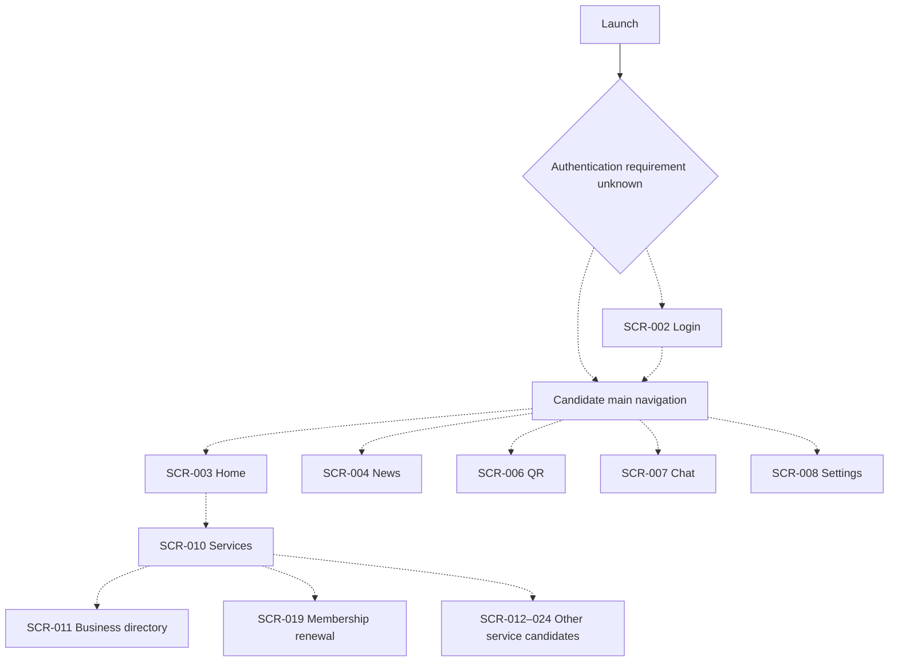

# SCREEN-INVENTORY.md — KADIN Indonesia Android v1.0.9

**Version:** 1.0 (static discovery baseline)  
**Date:** 2026-11-18  
**Reference:** `Kadin_Indonesia_1.0.9_build_8okt_v_1.apk`  
**Companion documents:** `APK-ANALYSIS.md`, `FEATURE-INVENTORY.md`, `UIUX-ANALYSIS.md`, `PRD.md`, `AGENTS.md`  
**Purpose:** Track candidate screens, navigation hypotheses, visual evidence, interaction states, and emulator verification for the next-generation KADIN Indonesia application.

> **Evidence limitation:** No emulator walkthrough, authenticated session, runtime screenshot, or verified React Navigation route tree is available. Screen entries below are **candidates**, not proof that the screens are implemented or accessible in the APK. The presence of an asset does not establish actual placement, appearance, or behavior. The PRD describes proposed successor functionality, not verified legacy functionality.

## 1. Evidence codes and acceptance rules

| Code | Meaning | Permitted assertion |
|---|---|---|
| C | Confirmed packaged artifact | Asset/config/library exists in APK |
| I | Indicated candidate | Asset name suggests a screen or component |
| H | Hypothesis | Proposed flow/content without direct runtime proof |
| U | Unknown | Cannot be determined from available evidence |
| V | Runtime-verified (future) | Screenshot + interaction trace + device/build metadata recorded |

**Rule:** Do not mark any screen `V` until captured and reproduced on an authorized device/emulator. Do not infer authentication, payment, QR semantics, or backend behavior solely from filenames.

## 2. Candidate navigation structure (NOT a recovered route tree)



Dashed arrows denote hypotheses, not observed transitions. Tab order, tab count, QR behavior, and guest access are unverified.

## 3. Screen register

| ID | Candidate screen | Candidate entry point | Packaged evidence | Status | Discovery priority |
|---|---|---|---|---|---|
| SCR-001 | Splash / launch | App start | Expo app identity (no dedicated screen proof) | U | P0 |
| SCR-002 | Login | Launch/account | `bg-login` | I | P0 |
| SCR-003 | Home | Main navigation | `home-active`, `home-unactive` | I | P0 |
| SCR-004 | News list | Main navigation | `news-active`, `news-unactive` | I | P0 |
| SCR-005 | News detail | News item | No direct named asset | H | P0 |
| SCR-006 | QR | Main navigation | `qr-active`, `qr-unactive` | I | P0 |
| SCR-007 | Chat / assistant | Main navigation | `chat-unactive`, `chat-new`, `chat-assistant` | I | P0 |
| SCR-008 | Settings | Main navigation | `setting-active`, `setting-unactive` | I | P0 |
| SCR-009 | Profile / account | Settings/account | `user-2` (profile usage unproven) | H | P0 |
| SCR-010 | Service catalogue | Home/menu | `service` | I | P0 |
| SCR-011 | Business directory | Service catalogue | `business-directory` | I | P1 |
| SCR-012 | Business forum | Service catalogue | `business-forum` | I | P1 |
| SCR-013 | Chat forum | Services/chat | `chat-forum` | I | P1 |
| SCR-014 | KADIN provinces | Service catalogue | `kadin-provinsi` | I | P1 |
| SCR-015 | Associations | Service catalogue | `asosiasi` | I | P1 |
| SCR-016 | Training & certification | Service catalogue | `training-and-certification` | I | P1 |
| SCR-017 | Business mentoring | Service catalogue | `business-mentoring` | I | P1 |
| SCR-018 | Business development | Service catalogue | `business-development` | I | P1 |
| SCR-019 | Membership renewal | Services/account | `membership-renewal` | I | P0 |
| SCR-020 | Events / calendar | Home/services | `kalender` | I | P1 |
| SCR-021 | COO service | Service catalogue | `coo` | I | P1 |
| SCR-022 | ATA Carnet service | Service catalogue | `atacarnet` | I | P1 |
| SCR-023 | APEC service | Service catalogue | `apec` | I | P1 |
| SCR-024 | Other services | Service catalogue | `other` | I | P2 |

**Discovery priority** refers to verification order, not an implementation commitment. The companion PRD's P0/P1/P2 implementation priorities are separate decisions.

## 4. Screen detail templates — highest-priority candidates

### SCR-002 — Login
- **Evidence:** `bg-login` asset name; actual layout and method unknown.
- **Verify:** launch entry, guest access, form fields, OTP/SSO/password, validation, loading, error, recovery, consent, session persistence.
- **Capture:** initial screen, focus/keyboard, invalid input, network failure, successful sign-in with authorized test account.
- **Do not assume:** phone OTP, KADIN membership database, or SSO integration.

### SCR-003 — Home
- **Evidence:** home active/inactive icon pair.
- **Verify:** first screen after launch/login, header, quick actions, service tiles, feeds, personalization, bottom navigation.
- **Capture:** top and scroll regions, empty/loading/error states, tap destinations.

### SCR-004 / SCR-005 — News list and detail
- **Evidence:** news icon pair; detail page is hypothetical.
- **Verify:** feed, article navigation, search/filter, pagination, external links, share actions, offline behavior.
- **Capture:** list and any actual detail screen, loading/empty/error states.

### SCR-006 — QR
- **Evidence:** QR active/inactive icon pair; `kta-bg.png` packaged separately.
- **Verify:** QR display vs scanner, membership card presence, camera permission, refresh/expiry, error states.
- **Do not assume:** QR encodes member identity or can be verified without backend authorization.

### SCR-007 — Chat
- **Evidence:** `chat-unactive`, `chat-new`, `chat-assistant`.
- **Verify:** human chat vs assistant vs forum, composer, attachments, unread states, moderation, authentication, consent.
- **Capture:** empty chat, active chat with test data, loading/send/error states.

### SCR-008 / SCR-009 — Settings and profile
- **Evidence:** settings icon pair; `user-2` asset.
- **Verify:** account details, preferences, logout, notifications, profile editing, deletion/privacy controls.
- **Capture:** navigation, confirmation dialogs, session-end behavior.

### SCR-010 / SCR-019 — Services and membership renewal
- **Evidence:** `service`, `membership-renewal` assets.
- **Verify:** catalogue taxonomy, entry points, whether service is native, WebView or external; renewal form, eligibility, payment only if observed.
- **Capture:** catalogue and each reachable step with synthetic data.

## 5. Visual component inventory

| Component ID | Candidate component | Evidence | Known vs unknown |
|---|---|---|---|
| CMP-01 | KADIN logo | `logo-kadin-new`, `assets/kadin-logo.png` | Asset exists; placement unknown |
| CMP-02 | Login background | `bg-login` | Asset name exists; composition unknown |
| CMP-03 | Main tab icons | `home-*`, `news-*`, `qr-*`, `setting-*` | Active/inactive variants suggested; exact style unknown |
| CMP-04 | Chat icons | `chat-unactive`, `chat-new`, `chat-assistant` | Function and placement unknown |
| CMP-05 | Service category icons | Named service assets | Tile/grid/list composition unknown |
| CMP-06 | Profile indicator | `user-2` | Usage unknown |
| CMP-07 | Membership card background | `assets/kta-bg.png` | Whether displayed in QR/profile unknown |
| CMP-08 | Placeholder image | `placeholder` | Loading/empty/default usage unknown |

**Design tokens not established:** brand hex values in UI, fonts, spacing, radii, elevations, animations, dark mode, responsive breakpoints, accessibility labels. Do not invent measurements and present them as extracted from the APK.

## 6. Runtime capture protocol (Android Studio)

1. Record APK SHA-256, emulator/device model, Android API level, resolution, density, language, network state, and test account category.
2. Install the authorized reference APK. Capture first launch, permissions, login/guest entry, and visible navigation.
3. For each reachable screen, record screen ID, exact visible title, entry action, previous/next destination, scroll regions, inputs, buttons, dialogs, and links.
4. Capture normal, loading, empty, error, offline, and permission-denied states where safely reproducible.
5. Record screen transitions and back behavior. Label unvisited or access-restricted routes `U`, not absent.
6. Sanitize screenshots/logs: redact names, member IDs, QR payloads, credentials, tokens, and personal data.
7. Store evidence under `reference/screenshots/` and notes under `analysis/runtime/`; keep source APK and decompiled output outside the new application's source tree.

Example commands:

```bash
adb devices
adb install -r input/reference.apk
adb exec-out screencap -p > reference/screenshots/SCR-003-home-observation.png
adb shell wm size
adb shell wm density
adb logcat -d -v time > analysis/runtime/logcat-raw.txt
```

**Caution:** Logcat may contain sensitive information. Redact it before sharing or committing; avoid committing raw logs or third-party assets.

## 7. Evidence capture sheet

| Field | Required value |
|---|---|
| Screen ID | `SCR-XXX` |
| Screen title | Exact user-visible text, or `Unknown` |
| Status | `V`, `I`, `H`, or `U` |
| Source | APK asset / screenshot / runtime trace |
| Device/build | Android version, emulator model, APK hash |
| Entry point | User action and previous screen |
| Visible components | Headers, tabs, cards, forms, icons |
| Interaction | Tap, scroll, input, back, deep link |
| State coverage | Default, loading, empty, error, offline |
| Data sensitivity | Redaction required / not required |
| Screenshot | Local relative path, if captured |
| Reviewer/date | Reviewer and verification date |
| Open questions | Unresolved behavior and follow-up |

## 8. Screen-by-screen acceptance criteria

A screen can be marked **runtime verified** only if:

- [ ] It is reached on the actual reference APK in a recorded environment.
- [ ] Its title, route/entry point, and visible controls are captured.
- [ ] Its primary interaction and back behavior are observed.
- [ ] At least its default state is documented; unavailable states are explicitly marked untested.
- [ ] Any authenticated observation uses authorized test access.
- [ ] Screenshots and logs are sanitized before inclusion in AI prompts or repositories.
- [ ] Reviewer/date and evidence location are recorded.

## 9. Traceability to successor application

Maintain mapping: `SCR-XXX` → `MOD-XX` → `PRD Epic/User Story` → `new route/component` → `test case`. Do not infer that a candidate screen must be reproduced in the successor app; product owner approval and independent design are required. Screen comparison should evaluate task completion, clarity, accessibility, and functional parity—not reproduction of proprietary code or visual assets.

## 10. Outstanding discovery decisions

1. Exact tab count/order and navigation library/route structure.
2. Guest access vs mandatory authentication.
3. QR function: display, scanner, member verification, or combination.
4. Chat assistant vs person-to-person vs forum capabilities.
5. Actual service catalogue and active/inactive service entries.
6. Native vs WebView vs external handoff for special services.
7. UI colors, typography, spacing, and component specifications.
8. Screen-level error, offline, accessibility, and localization behavior.

## 11. Next artifacts

- `SCREEN-CAPTURE-LOG.md`: evidence and screenshots from emulator.
- `NAVIGATION-MAP-VERIFIED.md`: actual route transitions.
- `DESIGN-SYSTEM.md`: approved independent design tokens and reusable components.
- `TRACEABILITY.md`: mapping from observed behaviors to PRD and tests.

**Document status:** Ready for runtime verification; not a validated screen reconstruction.
