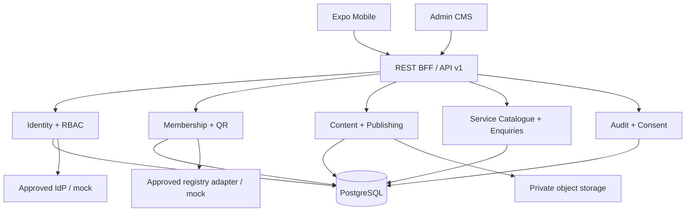
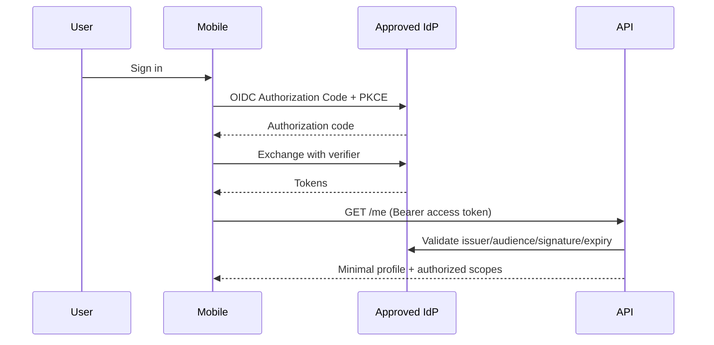
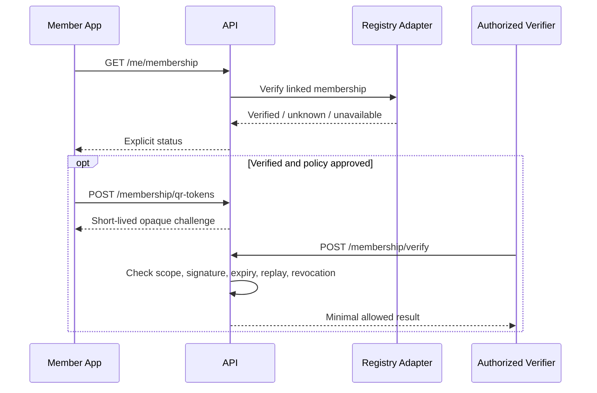
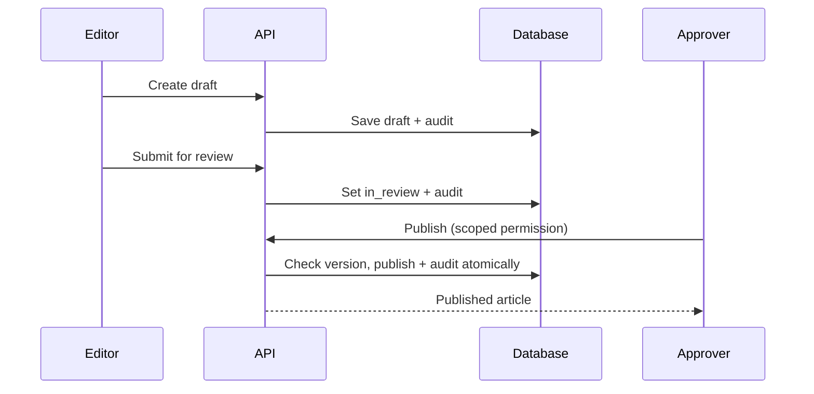

# SDD.md — KADIN Indonesia Next Generation Mobile Platform

**Software Design Document** | **Version:** 1.0 | **Date:** 2026-11-18  
**Status:** Proposed implementation baseline — NOT approved for production  
**Inputs reviewed:** `PRD.md`, `SAD.md`, `AGENTS.md`, `APK-ANALYSIS.md`, `FEATURE-INVENTORY.md`, `UIUX-ANALYSIS.md`, `SCREEN-INVENTORY.md`.

## 1. Purpose and evidence boundary

Translate the approved *direction* in PRD/SAD into actionable software specifications for Codex/OpenCode. The original APK is an observational reference only. **Do not copy decompiled source, branding, protected artwork, tokens, or unapproved service endpoints.** Features inferred from APK assets remain unverified. Every implementation item must trace to a proposed requirement or authorized runtime observation. This SDD is a **design proposal**, not a description of recovered original implementation.

## 2. Design baseline and unresolved decisions

| Layer | Proposed design | Decision gate |
|---|---|---|
| Mobile | React Native, Expo, TypeScript strict | ADR-001 Expo managed/prebuild; ADR-002 routing |
| UI | Feature-first screens, reusable design tokens, accessible components | Approve design system and navigation |
| Backend | TypeScript modular monolith, REST BFF | ADR-007 framework/hosting |
| Storage | PostgreSQL; migrations; private object storage | ADR-007/008 |
| Identity | OIDC Authorization Code + PKCE via approved IdP | ADR-003, blocked for live auth |
| Authorization | Server-enforced RBAC with organization scope | ADR-006 |
| Membership | Read-only registry adapter, verified source of truth | ADR-004, blocked for live data |
| QR | Short-lived server-issued verification challenge | ADR-005, blocked for live issuance |
| CMS | Restricted web admin with editorial workflow | ADR-006/007 |
| P1/P2 | Events, directories, payments, AI | Separate release approvals |

**API conflict to resolve:** PRD proposes `/api/v1/public/news`, `/api/v1/public/services`, `/api/v1/membership/qr-tokens`, `/api/v1/membership/verify`, `/api/v1/service-requests`; SAD examples use `/api/v1/news`, `/api/v1/services`, `/api/v1/me/card/challenges`, `/api/v1/qr/verify`, `/api/v1/service-enquiries`. This SDD adopts **PRD naming as provisional canonical contracts**, except it uses `GET /api/v1/me/membership` consistently. No legacy or production endpoint is claimed. Confirm this decision in an ADR before integration.

## 3. Proposed repository structure

**Repository layout:** `docs/adr/ADR-012-repository-layout-canonicalization.md` (ACCEPTED) is the single source of truth for the repository tree, including `apps/mobile/src/{app,features,navigation,shared}` and the `packages/` set. This section deliberately does not restate it.

Use a workspace package manager selected in ADR-007. Do not introduce a second router, state-management library, or ORM without a recorded decision.

## 4. Mobile design

### 4.1 Feature modules

| Module | Screens / views (proposed) | Client state | Data boundary |
|---|---|---|---|
| Shell | Splash, welcome, home, navigation | session / flags | BFF |
| Auth | Sign-in, callback, sign-out, consent | ephemeral auth state | approved IdP adapter |
| Membership | Profile, membership status, digital card | verified state; no assumed membership | membership BFF |
| QR | Card challenge, verifier result | short-lived in-memory token | QR BFF |
| Content | News list, detail, search/filter | paginated remote cache | public content API |
| Services | Catalogue, detail, enquiry | remote cache, draft form | service API |
| Settings | Preferences, consent, support | local preferences and server consent | account API |
| P1 | Events, directory, regional, renewal, learning | feature-gated | respective APIs |
| P2 | Messaging, AI copilot | opt-in and gated | approved AI service |

These screens are target designs, not verified APK screen captures.

### 4.2 Component contracts

- `AppShell`: navigation, auth-aware entry, error boundary, global accessibility labels.
- `ScreenLayout`: safe areas, scroll behavior, keyboard handling, loading/empty/error slots.
- `ArticleCard`: title, category, date, accessible image alternative, navigation callback.
- `ServiceCard`: title, description, eligibility summary, actionable CTA.
- `MembershipStatus`: `verified_active | verified_expired | pending | unknown | unavailable`; never infer `active` from cached user profile.
- `DigitalCard`: only approved member claims; no raw sensitive identifiers in screenshots/analytics.
- `QrChallengeView`: expiry countdown, refresh action, clear failure states, no offline promise.
- `FormField`: schema-based validation, error text, screen-reader description.

### 4.3 Mobile data and security

Use typed API client, explicit request cancellation, retry only for safe idempotent reads, and bounded pagination. Cache only public or explicitly approved non-sensitive data. Store credentials in platform secure storage; never in AsyncStorage, URLs, logs, or crash metadata. Client-side guards are UX only; backend performs all authorization. Handle airplane mode, expired sessions, 401, 403, 429, and server outages explicitly.

## 5. Backend module design



Each domain exposes application services, repository interfaces, validation schemas, and explicit API controllers. Cross-domain writes occur through an application service transaction; avoid direct imports of another module's persistence implementation. External providers are ports/adapters with synthetic mocks until authorized.

## 6. Proposed relational data model

All primary keys UUID, all timestamps UTC, schema migrations version-controlled, referential integrity enforced. Names below are proposed; data residency, retention and personal-data classification remain legal/data-owner decisions.

| Table | Essential fields | Constraints / indexes |
|---|---|---|
| `users` | `id`, `external_subject`, `display_name`, `created_at`, `updated_at` | unique `(external_subject)`; minimal PII |
| `organizations` | `id`, `parent_id`, `type`, `name`, `status` | FK parent; index parent |
| `role_assignments` | `id`, `user_id`, `organization_id`, `role`, `active_from`, `active_until` | scoped role lookup index |
| `consent_records` | `id`, `user_id`, `purpose`, `policy_version`, `granted`, `recorded_at` | append-only event semantics |
| `membership_links` | `id`, `user_id`, `registry_ref`, `verification_status`, `checked_at` | unique active mapping per authority; no unsupported active claims |
| `qr_challenges` | `id`, `membership_link_id`, `nonce_hash`, `expires_at`, `consumed_at`, `revoked_at` | index expiry; unique nonce hash |
| `articles` | `id`, `slug`, `title`, `summary`, `body`, `status`, `organization_id`, `author_id`, `published_at`, `version` | unique slug within agreed scope; status/date index |
| `media_assets` | `id`, `storage_key`, `mime_type`, `owner_id`, `visibility`, `created_at` | no public bucket by default |
| `services` | `id`, `code`, `title`, `description`, `status`, `organization_id`, `eligibility_json` | unique code; published index |
| `service_requests` | `id`, `service_id`, `requester_id`, `organization_id`, `status`, `created_at` | owner/scope indexes |
| `audit_events` | `id`, `actor_id`, `action`, `target_type`, `target_id`, `organization_id`, `request_id`, `created_at` | append-only; actor/time index |

**Important:** The tables are conceptual DDL specifications, not migrations ready for production. Add explicit retention, encryption/key management, tenancy tests and policy approval before live data use.

### 6.1 Illustrative SQL migration (synthetic starter)

```sql
CREATE TABLE organizations (
  id uuid PRIMARY KEY,
  parent_id uuid REFERENCES organizations(id),
  type text NOT NULL,
  name text NOT NULL,
  status text NOT NULL DEFAULT 'active'
);
CREATE TABLE users (
  id uuid PRIMARY KEY,
  external_subject text NOT NULL UNIQUE,
  display_name text,
  created_at timestamptz NOT NULL DEFAULT now(),
  updated_at timestamptz NOT NULL DEFAULT now()
);
CREATE TABLE articles (
  id uuid PRIMARY KEY,
  slug text NOT NULL UNIQUE,
  title text NOT NULL,
  summary text,
  body text NOT NULL,
  status text NOT NULL CHECK (status IN ('draft','in_review','published','archived')),
  organization_id uuid REFERENCES organizations(id),
  author_id uuid REFERENCES users(id),
  published_at timestamptz,
  version integer NOT NULL DEFAULT 1
);
CREATE INDEX articles_public_feed_idx ON articles(published_at DESC)
  WHERE status = 'published';
```

Complete migrations must include the remaining entities, FK policy, constraints, data access rules and tested rollback/forward migration procedures.

## 7. Canonical provisional REST API contracts

Base: `/api/v1`. OpenAPI 3.1. JSON, ISO-8601 UTC, cursor pagination, `X-Request-Id`, standard error envelope. These are **new proposed contracts**.

| Method | Path | Auth | Result | Priority |
|---|---|---|---|---|
| GET | `/public/news?cursor=&limit=` | none | paginated published articles | P0 |
| GET | `/public/news/{id}` | none | published article detail | P0 |
| GET | `/public/services?cursor=&limit=` | none | paginated active services | P0 |
| GET | `/public/services/{id}` | none | service detail | P0 |
| GET | `/me` | member | user profile | P0 gated |
| GET | `/me/membership` | member | verified membership status | P0 gated |
| POST | `/membership/qr-tokens` | verified member | challenge + expiry | P0 gated |
| POST | `/membership/verify` | authorized verifier | limited verification result | P0 gated |
| POST | `/service-requests` | user, per policy | request id/status | P0 gated |
| GET | `/service-requests/{id}` | owner or scoped operator | request detail | P0 gated |
| POST | `/admin/articles` | scoped editor | draft article | P0 gated |
| POST | `/admin/articles/{id}/submit-review` | scoped editor | in_review article | P0 gated |
| POST | `/admin/articles/{id}/publish` | scoped approver | published article | P0 gated |

**Error envelope** (example):

```json
{
  "error": {
    "code": "MEMBERSHIP_NOT_VERIFIED",
    "message": "Membership verification is unavailable or incomplete",
    "requestId": "req_example_001"
  }
}
```

**Pagination** (example):

```json
{
  "data": [{"id":"example-uuid","title":"Sample article"}],
  "page": {"nextCursor": null, "limit": 20}
}
```

Validation: maximum page size configurable; whitelist filters; typed response DTOs; do not expose stack traces. Use `Idempotency-Key` on transactional POSTs; preserve response on retries according to documented TTL.

## 8. Critical sequence designs

### 8.1 Member authentication (approval-gated)



Never implement a custom password store unless separately authorized. Use synthetic IdP during initial development.

### 8.2 Membership and QR (approval-gated)



No static QR carrying full member PII. Define TTL, revocation, verifier enrollment, nonce handling, audit retention and offline policy in ADR-005 before live use.

### 8.3 Editorial approval



Publishing requires scoped approval and optimistic concurrency (`version`/ETag). Prevent self-approval if organization policy requires separation of duties.

## 9. Role and access matrix (proposal)

| Action | Guest | Member | Editor | Approver | Org Admin | Platform Admin |
|---|---|---|---|---|---|---|
| Read published news/services | Yes | Yes | Yes | Yes | Yes | Yes |
| Read own profile/membership | No | Own | Own | Own | Own | Own |
| Create QR challenge | No | Verified only | Verified only | Verified only | Verified only | Verified only |
| Submit service request | Policy | Policy | Policy | Policy | Policy | Policy |
| Draft content | No | No | Scoped | Scoped | Scoped | Policy |
| Approve/publish content | No | No | No | Scoped | Policy | Policy |
| Manage org roles | No | No | No | No | Scoped | Governed |
| Read audit records | No | No | No | No | Scoped subset | Governed |

Roles do not automatically confer verifier privilege; use a separate verifier entitlement. All scope checks run server-side. The matrix requires ADR-006 approval.

## 10. Security and privacy design

- Verify JWT issuer, audience, algorithm, signature, expiry, and key rotation against approved IdP metadata.
- Use OIDC PKCE; secure token storage; short session lifetime and revocation policy.
- Validate all inputs at API boundary; parameterized SQL/ORM; output encoding; file MIME/size checks.
- Enforce organization scope on every read/write; negative cross-tenant tests are mandatory.
- Apply rate limits to login-related flows, QR issuance/verification, public APIs and service submissions.
- Encrypt in transit and at rest; use managed secrets; redact PII from logs and analytics.
- Maintain append-only audit semantics for admin, consent, role, publication and verification events.
- Define backups, restore tests, RPO/RTO, incident response, retention, and deletion with data owner.
- Never embed credentials, production tokens, or APK-derived third-party secrets in source or AI prompts.

## 11. State machines and business rules

**Article:** `draft -> in_review -> published -> archived`; rejection returns to `draft`; transitions require permissions and audit.

**Membership:** `unknown | pending | verified_active | verified_expired | unavailable`; registry authority determines verified states. Network failure returns `unavailable`, never silently `verified_active`.

**Service request:** `submitted -> triaged -> in_progress -> resolved | rejected | cancelled`; transitions, operator assignments and SLA require business approval.

**QR challenge:** `issued -> consumed | expired | revoked`; a consumed challenge cannot be reused; clock skew policy explicit.

## 12. Testing specification and acceptance gates

Follow **RED → GREEN → REFACTOR** for all new behavior. Discover the repository's actual test commands and use checked-in wrappers; do not claim tests passed without execution.

| Test ID | Scenario | Expected outcome |
|---|---|---|
| AUTH-001 | Unauthenticated user opens protected route | Redirect to sign-in, no private data |
| AUTH-002 | Expired/invalid access token | API 401; safe reauthentication |
| RBAC-001 | Editor accesses another org's draft | 403/404 with no data leak |
| RBAC-002 | Editor attempts publish without approver permission | 403 and no state change |
| NEWS-001 | Guest requests published feed | Only published records, stable pagination |
| NEWS-002 | Concurrent editorial update | Version conflict, no lost update |
| MEM-001 | Registry unavailable | Explicit unavailable state, no active claim |
| MEM-002 | Unknown registry response | No fabricated member identity |
| QR-001 | Valid unexpired challenge | Authorized verifier sees minimal result |
| QR-002 | Replay/expired/revoked challenge | Denied; auditable event |
| SRV-001 | Duplicate idempotent service submission | Single logical request |
| UI-001 | Offline news feed | Approved cached public data or clear offline state |
| UI-002 | Screen reader / dynamic text | Labels, focus order, no clipped essential actions |
| SEC-001 | Logs and analytics inspection | No tokens, QR payloads, or unnecessary PII |

Test pyramid: unit (validation/domain/state), integration (repository/API/database), contract (OpenAPI/client DTO), E2E (critical journeys), security (RBAC/tenant isolation), performance (measured against approved SLOs). Do not fix arbitrary coverage percentages until the engineering quality baseline is approved.

## 13. Observability, resilience and operational design

Use correlation IDs, structured redacted logs, error rates, latency percentiles, service health, deployment metadata, and domain audit events. Public-content cache may degrade gracefully; identity/QR verification must fail closed. Implement request timeout and circuit breaker for approved external registry adapters; do not treat stale membership data as verified. Define SLOs and alert thresholds with operations before production; avoid invented availability guarantees.

## 14. Delivery backlog and implementation order

| Sprint / work package | Deliverable | Dependency | Gate |
|---|---|---|---|
| WP-00 | Repository, CI, strict TS, lint, test harness, mock API | None | Toolchain checks green |
| WP-01 | Design system, shell, navigation, accessibility | ADR-001/002 | UI tests |
| WP-02 | Public news list/detail and services catalogue | Synthetic seeded API | Contract + integration tests |
| WP-03 | Admin article draft/review/publish | ADR-006, CMS choice | RBAC + audit tests |
| WP-04 | Authentication and consent | ADR-003/008 | IdP integration security tests |
| WP-05 | Membership status and profile | ADR-004 | Registry contract tests |
| WP-06 | Digital card/QR verification | ADR-005 | Replay/revocation/verifier tests |
| WP-07 | Service enquiries and operational workflow | Routing owner approval | State + idempotency tests |
| WP-08 | Release hardening | All P0 gates | E2E, privacy, restore, release review |

P1/P2 are not implicitly approved by this document. Each work package must be implemented with tests and reviewable pull requests.

## 15. Codex/OpenCode execution contract

For each task, the agent must: (1) read `AGENTS.md`, PRD/SAD/SDD and relevant ADR; (2) cite requirement and test IDs; (3) identify blocked decisions; (4) write a failing test; (5) implement minimum functionality; (6) run focused and full test suites; (7) record changed files, commands and results; (8) request human approval before production integrations, schema-breaking changes, privileged permissions or deployment.

**First safe task:** `WP-00` repository bootstrap plus synthetic data, followed by `WP-01` shell. Live IdP, registry and QR remain blocked.

### Agent kickoff prompt

```text
Read AGENTS.md, docs/PRD.md, docs/SAD.md and docs/SDD.md.
Implement WP-00 only. Treat all ADRs marked OPEN/BLOCKING as unresolved.
Use clean-room independent code, synthetic fixtures, strict TypeScript and TDD.
First inspect the repository and existing build/test conventions.
Write failing tests for the initial application shell contracts, then implement.
Run actual checks and report exact commands/results; do not claim success otherwise.
Do not connect to any legacy KADIN endpoint, live membership registry or IdP.
Produce a concise PR with changed files, tests, risks and next decisions.
```

## 16. Requirements traceability

| Requirement | Design module | Primary tests |
|---|---|---|
| PRD EPIC-01 Identity | Auth + consent | AUTH-001/002 |
| PRD EPIC-02 Home/navigation | Mobile shell | UI-001/002 |
| PRD EPIC-03 Membership | Membership + QR | MEM-001/002, QR-001/002 |
| PRD EPIC-04 News | Content | NEWS-001/002 |
| PRD EPIC-05 Services | Catalogue + enquiries | SRV-001 |
| PRD EPIC-06 Settings/support | Preferences + consent | AUTH-002, SEC-001 |
| PRD EPIC-07 Admin | CMS + RBAC + audit | RBAC-001/002, NEWS-002 |
| PRD EPIC-08–11 | P1 extensions | Future approved tests |
| PRD EPIC-12 | P2 AI/messaging | Future approved tests |

## 17. Definition of Ready / Done

**Ready:** requirement ID, accepted UX behavior, source/evidence confidence, API schema, test cases, dependencies and ADR approval known. **Done:** implementation independently written; relevant tests run and pass; no unresolved high-severity security findings; API docs/migrations updated; accessibility verified for affected flows; logging/privacy reviewed; PR reviewed; release gates approved. A mocked integration is labeled **mock**, never production-ready.

## 18. Open decisions and handoff

1. Approve route naming reconciliation between PRD and SAD; publish OpenAPI 3.1.
2. Select Expo managed/prebuild and navigation approach.
3. Select backend framework, ORM, hosting and CMS.
4. Confirm IdP, membership registry authority and organization hierarchy.
5. Approve QR semantics, verifier roles, TTL, revocation and audit.
6. Confirm Indonesian privacy/data governance, retention, residency and operating owners.
7. Confirm release SLOs, capacity assumptions, notification providers and CI/CD approvals.

**Handoff:** `SDD.md` is ready to guide **mock-first WP-00/WP-01 development**, but is not an authorization for live integration or production deployment.
