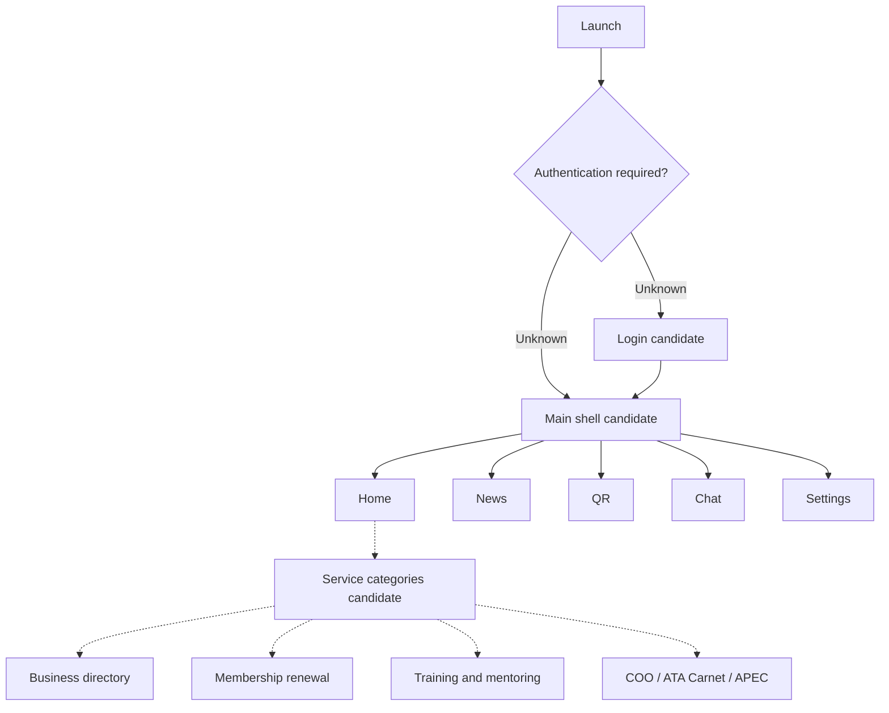

# UIUX-ANALYSIS.md — KADIN Indonesia Android v1.0.9

**Document version:** 1.0 (static-evidence baseline)  
**Date:** 2026-11-18  
**Reference APK:** `Kadin_Indonesia_1.0.9_build_8okt_v_1.apk`  
**Related documents:** `APK-ANALYSIS.md`, `FEATURE-INVENTORY.md`  
**Scope:** Navigation candidates, screen inventory, visual components, UX hypotheses, and validation protocol.

> **Evidence boundary:** This document is based on direct inspection of APK package metadata and Expo asset manifest, cross-checked with the supplied feature inventory. No emulator walkthrough, authenticated session, Hermes bundle disassembly, or runtime screenshot capture was performed. Accordingly, it does **not** claim to reconstruct the actual screen layouts or navigation tree.

## 1. Executive summary

The APK contains React Native/Expo artifacts and first-party image assets indicating candidate entry points for Home, News, QR, Chat, Settings, and Login. Named service assets indicate potential service-directory categories such as business directory, mentoring, membership renewal, and KADIN-specific services. Active/inactive icon pairs suggest selection-state treatment, but do not prove that a particular bottom-tab implementation exists.

**Verified artifact:** `assets/app.config` identifies application name `Kadin Indonesia`, version `1.0.9`, and Android package `com.kadinverse`. `assets/app.manifest` lists first-party image assets under `/assets/src/assets/images` and `/assets/src/assets/images/icons`.

**Recommended successor approach:** React Native + Expo + TypeScript as a candidate implementation stack; establish actual journeys and design tokens through emulator observation before freezing PRD or design system. Any new product should use independently authored source code and appropriately licensed assets.

## 2. Evidence classification

| Code | Meaning | Example |
|---|---|---|
| C | Confirmed artifact in APK | `home-active` appears in Expo asset manifest |
| I | Indicated UI element or screen | Home may be a navigational destination |
| H | Design hypothesis / proposed new-app behavior | QR page displays a membership card |
| U | Unknown without runtime evidence | Actual order of bottom tabs |
| R | Recommendation for successor app | Accessible tab labels and consistent back behavior |

Do not convert `I` or `H` into `C` without screenshot, runtime trace, or independently verified evidence.

## 3. Navigation inventory

| ID | Candidate destination | Evidence from packaged asset | Status | Runtime validation |
|---|---|---|---|---|
| NAV-01 | Home | `home-active`, `home-unactive` | I | Presence, tab label, order, logged-in state |
| NAV-02 | News | `news-active`, `news-unactive` | I | Feed/detail routing, filters, pagination |
| NAV-03 | QR | `qr-active`, `qr-unactive` | I | Member ID display versus scanner versus other purpose |
| NAV-04 | Chat | `chat-unactive`, `chat-new`, `chat-assistant` | I | Direct messaging, assistant, forum, or combination |
| NAV-05 | Settings | `setting-active`, `setting-unactive` | I | Profile/settings structure and logout |
| NAV-06 | Login | `bg-login` | I | Authentication screen and onboarding sequence |

### 3.1 Candidate information architecture — NOT recovered route tree



All edges above are **hypotheses** for test planning; even the presence of a main shell is not runtime-confirmed.

### 3.2 Navigation decisions pending verification

- Tab placement, count, order, active-state styling, and whether QR is a central action.
- Whether login is mandatory or guest browsing is allowed.
- Whether service categories open native screens, WebViews, or external sites.
- Android system back, nested navigation, modal behavior, and deep links.
- Whether Chat Assistant and Chat Forum are separate experiences.

## 4. Screen inventory — candidate, not verified

| Screen ID | Candidate screen | Entry point (hypothesis) | Expected content to inspect | Evidence | Status |
|---|---|---|---|---|---|
| SCR-001 | Splash / launch | App launch | Branding, loading, update checks | Expo app identity | U |
| SCR-002 | Login | Launch/account | Form, OTP, recovery, validation | `bg-login` | I |
| SCR-003 | Home | Main navigation | Header, shortcuts, cards, content | Home icon pair | I |
| SCR-004 | News list | News tab | Cards, categories, search | News icon pair | I |
| SCR-005 | News detail | News item | Article, sharing, related items | No direct asset | H |
| SCR-006 | QR | QR tab | QR display/scanning, permissions | QR icon pair | I |
| SCR-007 | Chat | Chat tab | Conversations, assistant, composer | Chat assets | I |
| SCR-008 | Settings | Settings tab | Account, preferences, logout | Settings icon pair | I |
| SCR-009 | Profile | Account | User data, member status | `user-2` | H |
| SCR-010 | Services | Home/service menu | Service tiles/categories | `service` | I |
| SCR-011 | Business directory | Services | Search, directory, profile | `business-directory` | I |
| SCR-012 | Business forum | Services | Posts/topics/conversations | `business-forum` | I |
| SCR-013 | Chat forum | Services/chat | Channels, participants, messages | `chat-forum` | I |
| SCR-014 | KADIN province | Services | Regional chapter list | `kadin-provinsi` | I |
| SCR-015 | Associations | Services | Association listing | `asosiasi` | I |
| SCR-016 | Training & certification | Services | Program list and detail | `training-and-certification` | I |
| SCR-017 | Business mentoring | Services | Mentors/programs | `business-mentoring` | I |
| SCR-018 | Business development | Services | Advisory/program list | `business-development` | I |
| SCR-019 | Membership renewal | Services/account | Renewal information or form | `membership-renewal` | I |
| SCR-020 | Events/calendar | Home/services | Events/calendar | `kalender` | I |
| SCR-021 | COO | Services | COO information/service | `coo` | I |
| SCR-022 | ATA Carnet | Services | ATA Carnet information/service | `atacarnet` | I |
| SCR-023 | APEC | Services | APEC information/service | `apec` | I |
| SCR-024 | Other services | Services | Additional category list | `other` | I |

No screen dimensions, visual hierarchy, or runtime screenshot is available for any candidate screen at this stage.

## 5. Packaged visual assets and component indications

### 5.1 First-party named image assets

The Expo manifest contains the following first-party asset names:

- **Branding / backgrounds:** `logo-kadin-new`, `bg-login`, `bg-dalam`, `placeholder`.
- **Tab icon states:** `home-active`, `home-unactive`, `news-active`, `news-unactive`, `qr-active`, `qr-unactive`, `setting-active`, `setting-unactive`.
- **Chat / profile:** `chat-unactive`, `chat-new`, `chat-assistant`, `user-2`.
- **Services:** `kalender`, `service`, `business-directory`, `business-forum`, `chat-forum`, `kadin-provinsi`, `asosiasi`, `training-and-certification`, `business-mentoring`, `business-development`, `membership-renewal`, `other`, `coo`, `atacarnet`, `apec`.

The APK also packages `assets/kadin-logo.png` and `assets/kta-bg.png`. Their presence does not establish where or whether they appear in the app.

### 5.2 Component candidates

| Component | Evidence | Confidence | Open question |
|---|---|---|---|
| Brand logo | `logo-kadin-new`, `kadin-logo.png` | C asset / I UI | Which screen and variant? |
| Login background | `bg-login` | C asset / I UI | Full bleed, illustration, or banner? |
| Selected/unselected tab icon | `*-active`, `*-unactive` | C asset / I UI | Colors, dimensions, animations? |
| Service tile icon | Service-named images | C asset / I UI | Grid/list, card shape, labels? |
| QR icon | `qr-active`, `qr-unactive` | C asset / I UI | Scanner or member ID? |
| Chat assistant entry | `chat-assistant` | C asset / I UI | Bot function or static icon? |
| Profile avatar/icon | `user-2` | C asset / I UI | Avatar, account menu, or placeholder? |
| Membership-card background | `kta-bg.png` | C asset / H usage | Digital KTA screen? |

### 5.3 Design tokens — unknown

Actual primary/secondary colors, typefaces used in app screens, spacing, corner radii, shadows, icon sizes, dark-mode behavior, and accessibility labels **cannot be established** from the current evidence. Font packages in the APK include common icon-font families, but that does not prove the app's primary text typography.

Do **not** claim specific hex colors, design dimensions, or component hierarchy until screens are captured. For the successor app, define design tokens only after authorized brand guidance and runtime observations.

## 6. UX journeys to observe

| Flow | Scenario | Screens to capture | State variants |
|---|---|---|---|
| UX-01 | Fresh install → first launch | Splash, onboarding/login | Loading, permission, failure |
| UX-02 | Login → Home | Auth, dashboard | Invalid input, offline, success |
| UX-03 | Home → News → detail | Feed, article | Empty, loading, network error |
| UX-04 | Main nav → QR | QR screen | Permission, expired/unavailable |
| UX-05 | Main nav → Chat | List/chat/assistant | Empty, sending, error |
| UX-06 | Services → Business Directory | Directory, filters, detail | No results, pagination |
| UX-07 | Services → Membership Renewal | Overview, form, confirmation | Ineligible, pending, success |
| UX-08 | Services → COO / ATA Carnet / APEC | Information, external handoff | WebView, error, back navigation |
| UX-09 | Settings → Profile → Logout | Settings/account | Confirmation, session end |
| UX-10 | Rotate / background / offline | Representative screens | State retention and recovery |

These are **test scripts**, not verified flows.

## 7. UX assessment rubric for emulator review

Score each verified screen on a 0–3 scale: 0 = not available, 1 = serious issue, 2 = usable with issues, 3 = good. Mark N/A where not applicable.

| Dimension | Inspection criteria |
|---|---|
| Discoverability | Navigation labels, findability, service grouping |
| Task efficiency | Steps/taps to complete a key journey |
| Information architecture | Hierarchy, terminology, duplication |
| Feedback & state | Loading, success, empty, error, retry |
| Forms | Input labels, keyboard, validation, error recovery |
| Accessibility | Contrast, text scaling, screen reader labels, touch targets |
| Trust & privacy | Permissions, sensitive data display, consent, logout |
| Performance perception | Initial render, skeleton/loading, responsiveness |
| Consistency | Buttons, cards, iconography, typography, spacing |
| Device resilience | Small screens, rotation, offline/background behavior |

Do not assign scores before observation.

## 8. Successor-app UI/UX recommendations (not claims about current APK)

1. **Primary navigation:** limit persistent top-level destinations to the most frequent member tasks; validate whether QR deserves a central action.
2. **Home:** prioritize membership status, quick services, news, events, and notifications based on member research.
3. **Services:** use a searchable, categorized directory with clear separation between informational content and transactional workflows.
4. **Membership:** make identity/renewal status explicit; avoid displaying sensitive identifiers unnecessarily.
5. **Chat:** distinguish human support, forum, and AI assistant with clear labels and response provenance.
6. **Accessibility:** support dynamic font scaling, semantic labels, keyboard focus, and adequate touch targets.
7. **State design:** specify loading, empty, error, offline, and permission-denied screens for every critical journey.
8. **Design system:** build reusable Compose-equivalent React Native components (navigation, cards, forms, service tiles, dialogs, skeletons), with brand-approved tokens.

## 9. Proposed new-app component library

| Component | Responsibility | Priority |
|---|---|---|
| `AppShell` | Safe areas, global navigation, session gating | P0 |
| `BottomNavigation` | Accessible top-level destinations | P0 |
| `BrandHeader` | Identity, title, actions | P0 |
| `ServiceTile` | Service icon, label, state | P0 |
| `NewsCard` | News preview and navigation | P0 |
| `MemberStatusCard` | Membership status without excessive PII | P0 |
| `FormField` | Validation, help, errors | P0 |
| `StateView` | Loading, empty, offline, error | P0 |
| `QRIdentityPanel` | Only if verified/approved in PRD | P1 |
| `ChatComposer` | Messaging/assistant interface | P1 |
| `EventCard` | Event listing and CTA | P1 |
| `ServiceCategoryGrid` | Searchable services | P1 |

This is a **proposal** for a clean-room successor, not a list of components recovered from the APK.

## 10. Runtime capture protocol (Android Studio)

1. Create a test emulator with a compatible Android version and Google APIs where needed.
2. Install the supplied APK; if it fails, document ABI, minimum SDK, and split-package errors.
3. Record app version, emulator configuration, display resolution, and test account role.
4. Capture first launch, each visible tab, every accessible service entry, and representative loading/empty/error states.
5. Record navigation transitions, system back behavior, permissions, and external handoffs.
6. Use synthetic data and an authorized account; redact PII, tokens, and identifiers from logs/screenshots.
7. Update screen and route inventories with actual evidence references.

Suggested commands:

```bash
adb devices
adb install -r input/reference.apk
adb exec-out screencap -p > reference/screenshots/launch.png
adb logcat -d -v time > analysis/runtime/logcat.txt
```

Review logs locally and redact secrets before sharing them with an AI agent. `adb` does not by itself reveal the React Native navigation tree or component hierarchy.

### Screenshot naming convention

`SCR-003_home_default.png`, `SCR-003_home_loading.png`, `SCR-003_home_error.png`, etc. Only create filenames for states actually captured.

### Runtime observation record

| Field | Example / instruction |
|---|---|
| Screen ID | `SCR-003` |
| Actual title | Copy exact visible text |
| Entry point | Observed tap/navigation |
| Previous / next screen | Actual transition |
| Components | Visible controls, labels, states |
| Permissions | Observed OS prompt |
| Role / authentication | Test role, no credentials |
| Screenshot | File path |
| Confidence | Observed / partial / unknown |
| Open questions | Unverified assumptions |

## 11. Acceptance criteria for UIUX-ANALYSIS v1.1

- [ ] First-launch and login flow captured on emulator.
- [ ] Actual navigation destinations and order verified.
- [ ] At least one screenshot per reachable top-level destination.
- [ ] Each candidate service classified as working, placeholder, external, restricted, or absent.
- [ ] Visual tokens measured from runtime screenshots or approved design files.
- [ ] Authenticated versus guest navigation documented.
- [ ] Loading, empty, error, and offline states sampled.
- [ ] Accessibility review performed on critical paths.
- [ ] User journeys approved by product owner before successor PRD finalization.

## 12. Traceability and limitations

**Direct evidence:** `assets/app.config`, `assets/app.manifest`, `assets/kadin-logo.png`, `assets/kta-bg.png` inside the supplied APK; corroboration from `FEATURE-INVENTORY.md`.

**Not inspected:** actual Hermes route definitions, UI runtime, live backend, user authentication, screenshots, screen recordings, and color/layout measurements.

**Legal/product boundary:** Preserve authorized observations and functional requirements; do not import proprietary decompiled code, assets, credentials, or unlicensed branding into an independently developed successor.

**Next document:** `SCREEN-INVENTORY.md` should be upgraded from candidates to runtime-confirmed screens once emulator captures are available.
